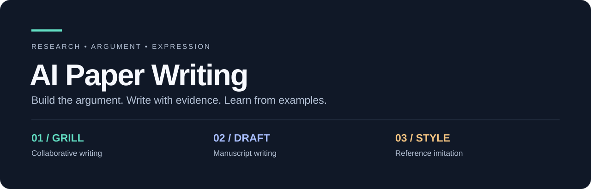

<p align="center"></p>

<p align="center"><strong>从研究证据到论文表达：三个模式，一套明确的写作流程。</strong><br>ICLR / ICML 统计 · CVPR 案例 · 段落与图表仿写</p>

<p align="center"><a href="README.md">English</a> · <a href="SKILL.md">Skill 入口</a> · <a href="SOURCE.md">来源说明</a></p>

## 三个模式

| 模式 | 使用场景 | 产物 |
| --- | --- | --- |
| **Grill** | 协作写作：希望通过讨论明确主张和表达 | 每次一个问题，给出推荐答案，依据你的决定逐步完成文字 |
| **Draft** | 论文写作：已有材料，需要直接起草、重构、润色或审查 | 完整稿件、章节修改、实验方案或有证据的审查结果 |
| **Style** | 示例仿写：希望学习指定论文的语言、段落、图表 | 来源到目标的映射，以及使用自身证据完成的文字或可编辑图表 |

三个模式都保护事实、数值、比较条件和不确定性。Grill 等待你的关键决定；Draft 和 Style 在信息充分时直接完成请求。

## 安装与调用

Codex：

```bash
git clone https://github.com/Alchemist-Jo/ai-paper-writing.git ~/.codex/skills/ai-paper-writing
```

Claude Code：

```bash
git clone https://github.com/Alchemist-Jo/ai-paper-writing.git ~/.claude/skills/ai-paper-writing
```

已有同名目录时先自行保留现有修改。此 skill 仅在明确选择时调用；保留 Claude 与 Codex 的手动调用配置。

```text
使用 $ai-paper-writing，Grill 模式。
基于这份初稿和实验结果，和我共同确定中心主张并修改引言。
每次只问一个问题，给出你的推荐答案和依据。
```

```text
使用 $ai-paper-writing，Draft 模式。
根据已有结果重构全文，利用统计结果安排章节与图表。
直接修改 LaTeX，保留数字，缺失结果明确占位。
```

```text
使用 $ai-paper-writing，Style 模式。
模仿这篇示范论文的方法段落和结果图，先看实际原文与图表。
学习段落功能、句式节奏、面板顺序和 caption，使用我的方法与数据完成产物。
```

## 统计如何参与写作

- **篇幅分配**：先确定论文类型和真实预算，再使用对应会议的模块比例，调整到当前证据需求。
- **段落组织**：用摘要功能与段落动作统计检查衔接，示范论文决定具体表达。
- **语言选择**：让 propose、show、find、observe 等动词与证据角色一致。
- **图表设计**：用面板、系列、caption 和字号分布校准密度，最终模板决定实际尺寸。
- **实验呈现**：明确分母、聚合、重复层级、误差含义、失败与成本。

保留 **250 篇 ICLR/ICML 的原始统计、68 份 CSV、250 份逐篇深读与 250 份视觉分析记录**。CVPR 保留案例实验数字及来源，未将其描述为大样本调查。样本频率不构成固定模板或录用预测。

## 仿写的具体过程

实际原文/图表 → 提取章节、段落、语言与视觉特点 → 对应自己的主张和数据 → 完成文字或图表 → 对照检查。

学习论证和视觉组织，使用原创表述与自己的结果。不能从范文转移数字、误差条或因果结论；只有文本时不声称已确认字体和颜色。制作图表的请求会继续完成源码与渲染。

## 资料与验证

- [统计决策规则](references/statistics-to-decisions.md)
- [CVPR / ICLR / ICML 适配](references/venue-adaptation.md)
- [示范论文仿写流程](references/reference-imitation.md)
- [完整来源说明](SOURCE.md)
- [验证记录及限制](reports/validation.md)

本次发布保留并检查原材料，未重新核验所有论文，也未进行论文质量提升的独立盲评。采用 MIT 许可，第三方材料保留原许可证与署名。
